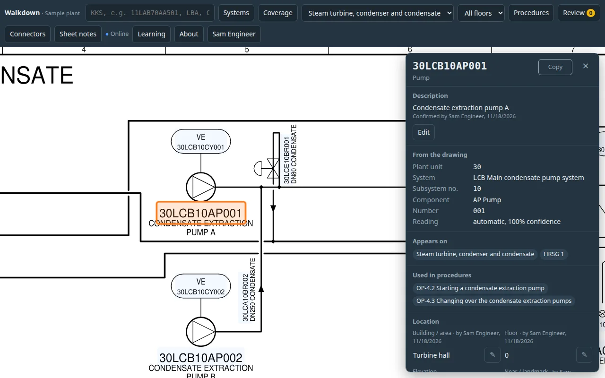
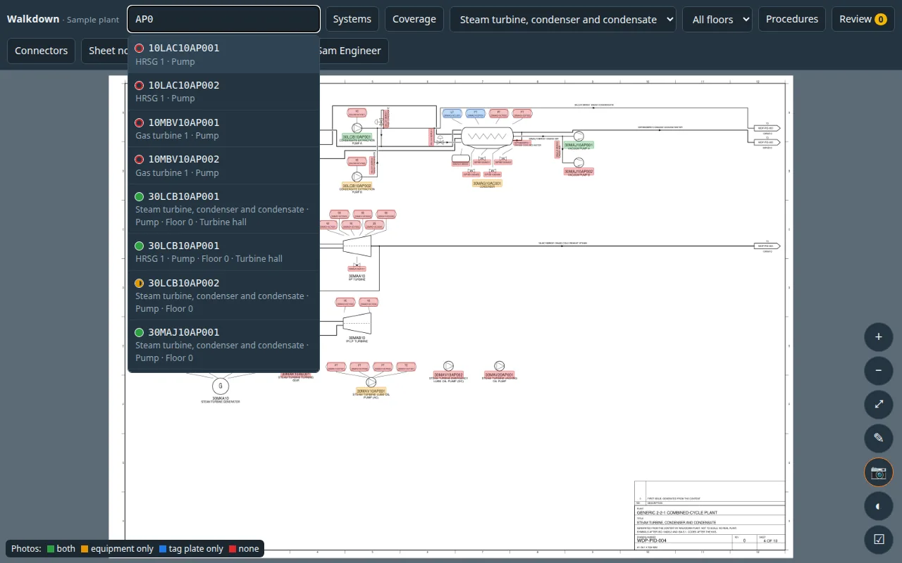
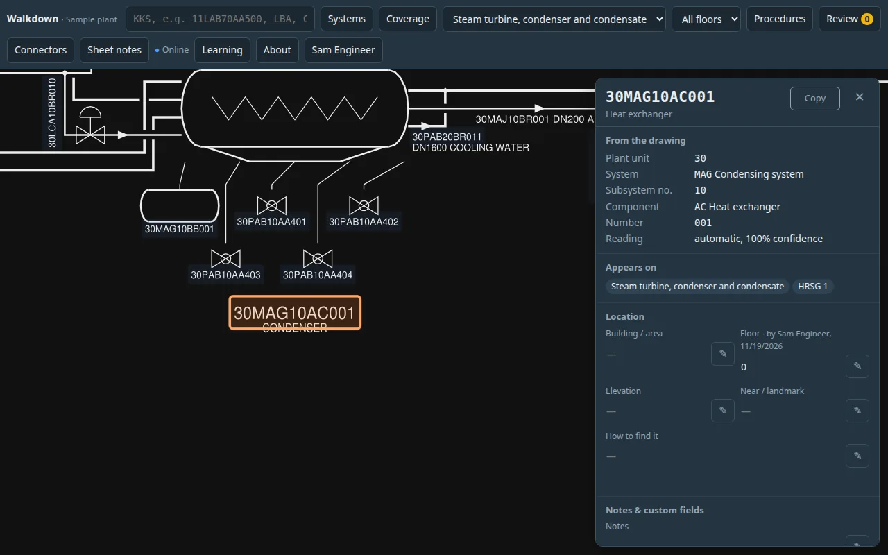
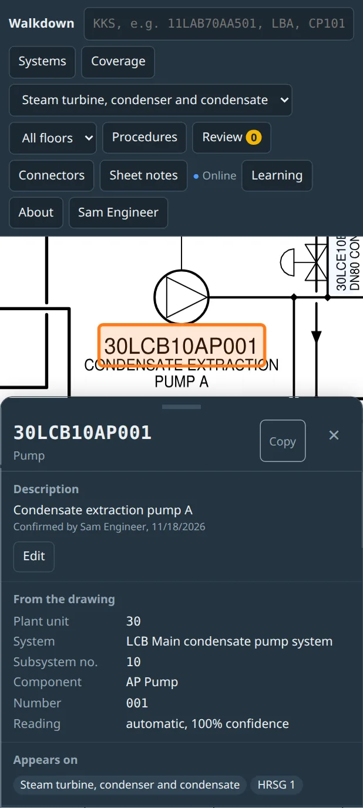
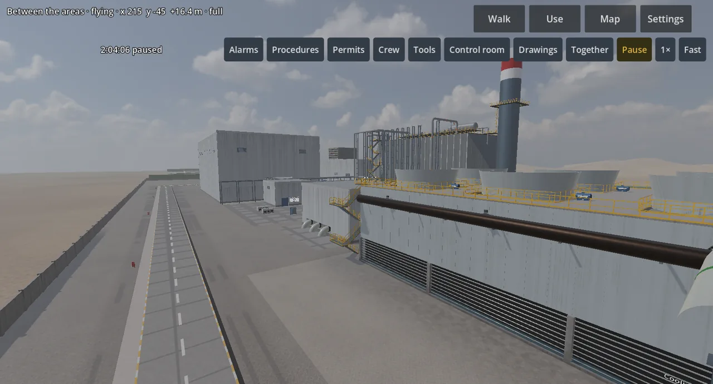
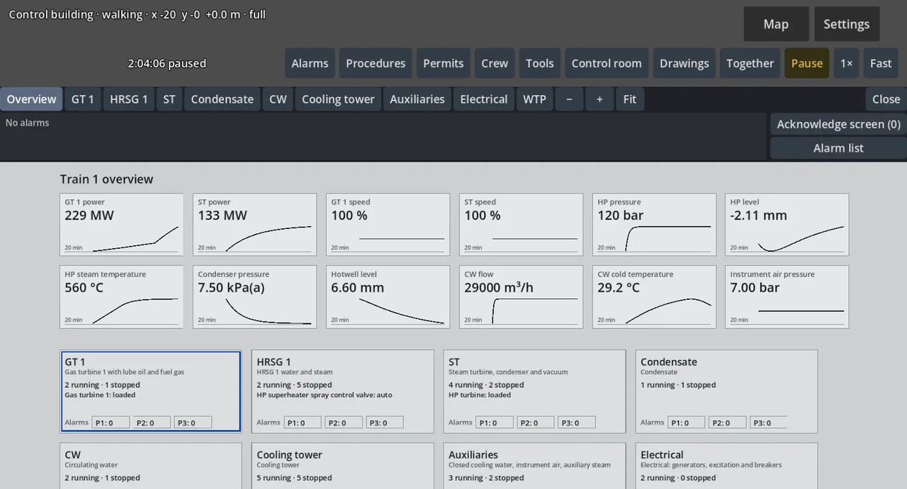
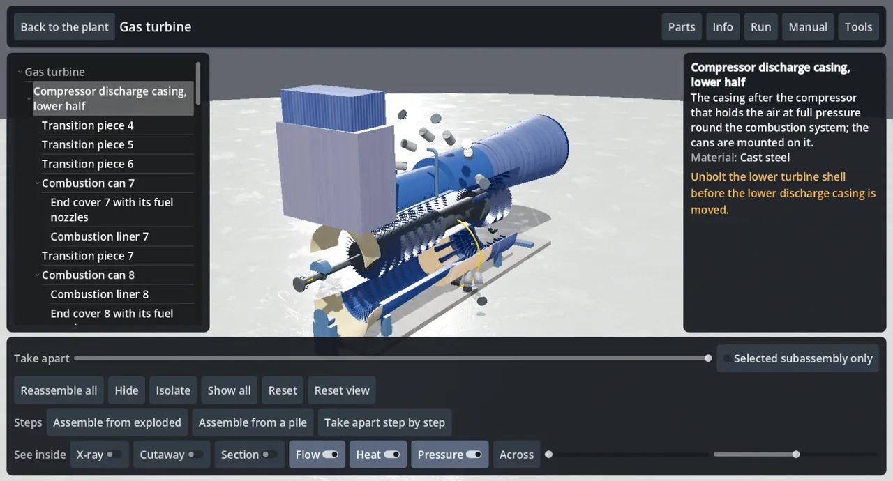
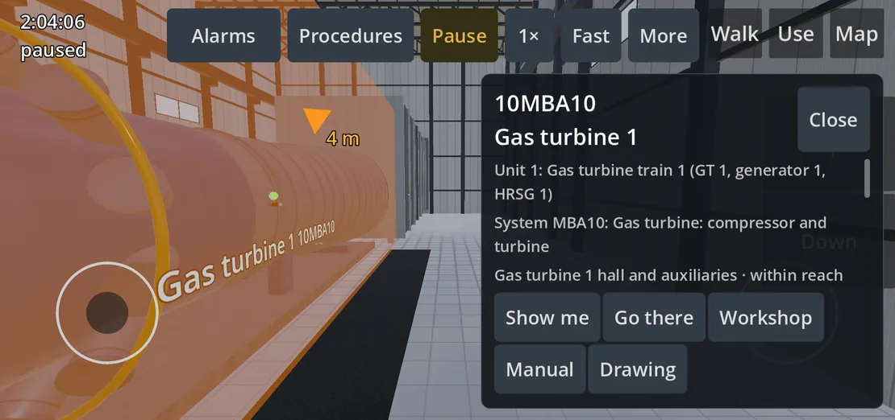

# Walkdown

<!-- read by CI; do not remove -->
Tier: T3
Type: web, native, service

*Formerly KKS Explorer (renamed 2026-10-03).*

Walkdown finds any KKS code on a power plant's P&ID drawings and shows everything known about it:
- the decoded code and where the equipment is;
- photos and notes;
- the operation-manual steps that use it.

It reads the tags straight off vector P&ID PDFs (AutoCAD plots, no text layer). Every device keeps the plant's signed,
append-only log and works offline. Devices sync with the plant's server and with each other, on the same Wi-Fi or
across the internet.

| | |
|---|---|
|  |  |
| A tag on the drawing and everything known about it: the decoded code, the sheets it is on, the procedures that use it, where it is, notes and photos. | Search by code or description. The photo marks show which tags still need an equipment or tag plate photo. |
|  |  |
| Dark drawings, for night shifts and dim rooms. | The same on a phone. |

The screenshots use made-up data: the drawings are Walkdown Plant's generated P&IDs of an invented plant.

- **Apps:** Android, Windows, Linux (GNOME), and the web pages for browsers. Get them from the
  [releases](https://github.com/5wHN28Dg/kks-explorer/releases) (tags `v…`).
- **Guides for teammates, the manager and the maintainer:** the [wiki](https://github.com/5wHN28Dg/kks-explorer/wiki).
  It covers [phones](https://github.com/5wHN28Dg/kks-explorer/wiki/Using-Walkdown-on-a-phone),
  [laptops](https://github.com/5wHN28Dg/kks-explorer/wiki/Laptops), the
  [manager's work](https://github.com/5wHN28Dg/kks-explorer/wiki/Manager-guide), the
  [server](https://github.com/5wHN28Dg/kks-explorer/wiki/Server) and
  [releasing](https://github.com/5wHN28Dg/kks-explorer/wiki/Releasing).
- **Building and testing:** [Development](https://github.com/5wHN28Dg/kks-explorer/wiki/Development), and the README
  of each part (`core/`, `apps/gnome/`, `apps/windows/`, `android/app2/`, `importer/`, `relay/`, `apps/plant3d/`,
  `relay-plant/`).
- **Specifications:** `docs/PROTOCOL-v2.md` (the log, sync, the v1 import), `docs/PATHSTORE.md` (drawings),
  `docs/COURSES.md` (courses), `docs/GLYPHLIB.md` (the reader's glyph library), `docs/PLANT3D.md` and
  `docs/plant3d/` (Walkdown Plant).
- **Why things are the way they are:** the decision records in `docs/decisions/`, and M6's requirements, capability
  matrix and measurements in `docs/m6/`.

## Accessibility

Walkdown is meant to work with a screen reader, with the keyboard alone, with large text and in a dark theme. It is checked with TalkBack on Android, Narrator on Windows, Orca on Linux (GNOME), and Orca with Firefox for the web app.

The apps follow the system's dark theme and text size. On a computer, the drawing pans with the arrow keys and zooms with + and −. Every tag can also be found by searching for its code or description, without seeing the drawing. Dark drawings help in dim rooms.

Apple devices (iPhone, iPad, Safari on a Mac) are not checked: there is none to test on. The web app is kept working on them as far as it can be without one, but VoiceOver is not checked.

Known gaps:

- Some buttons have no name for a screen reader, and some status messages are not announced ([#374](https://github.com/5wHN28Dg/kks-explorer/issues/374)).
- Some actions need a drag or a pinch and have no keyboard or tap alternative, such as marking up a photo ([#375](https://github.com/5wHN28Dg/kks-explorer/issues/375)). In the web app, two file pickers can't be reached with the keyboard ([#403](https://github.com/5wHN28Dg/kks-explorer/issues/403)).
- Large text, zoom and narrow windows can cut off or hide controls in the web app, on GNOME and on Android ([#376](https://github.com/5wHN28Dg/kks-explorer/issues/376)).
- Windows: the dark theme is not complete, and the system's text size and display scaling are not fully followed ([#377](https://github.com/5wHN28Dg/kks-explorer/issues/377)).
- Arabic notes can split a KKS code across the line in the web app, on Windows and on Android ([#379](https://github.com/5wHN28Dg/kks-explorer/issues/379)).
- Some text, highlights and borders have too little contrast ([#368](https://github.com/5wHN28Dg/kks-explorer/issues/368), [#369](https://github.com/5wHN28Dg/kks-explorer/issues/369)). Some states are shown by colour alone: a tag's state, photo coverage and course answers ([#370](https://github.com/5wHN28Dg/kks-explorer/issues/370)).
- Some touch targets are too small for gloves ([#367](https://github.com/5wHN28Dg/kks-explorer/issues/367)).
- The web app's course figures still move when the system asks for reduced motion ([#380](https://github.com/5wHN28Dg/kks-explorer/issues/380)).
- In the web app, the check with Orca and Firefox is not set up yet; until it is, the browser's accessibility tree is checked instead.

To report a barrier, tell your plant's manager, or open an issue at <https://github.com/5wHN28Dg/kks-explorer/issues> (Report a problem, in About). Leave plant data out of an issue: no codes, drawings, photos or names. A reported barrier counts as a major problem until it has been looked at.

## Walkdown Plant

A walkable 3D combined-cycle plant for training, made with Godot (`apps/plant3d/`), released separately (tags
`plant-v…`) for Android, Windows and Linux. The plant is generic and invented: it is not a copy of any real plant.

| | |
|---|---|
|  |  |
| The power block from outside: the HRSG and its stack, the steam turbine hall and the cooling tower. | The control room's screens at base load. |
|  |  |
| The Workshop: the gas turbine taken apart, each part named and described. | On a phone: the gas turbine hall with the equipment's card. |

It has:
- the first train to walk and operate (a gas turbine, its HRSG, the steam turbine, a wet cooling tower and the
  balance of plant), with control room screens, alarms, procedures and tours, the instructor's faults and generated
  P&IDs of its own;
- the water treatment plant, the site and the workers' camp;
- staff with roles who work the full day: shift changes, buses and meals; the trainee can take a role;
- permits to work and isolations with locks;
- lifts and hoists;
- weather, seen and heard;
- the Workshop: one piece of equipment by itself, taken apart and put back, run on its bench and seen inside
  (a pressure transmitter first);
- multiplayer sessions on a LAN;
- the start of the realism programme (`docs/plant3d/REALISM.md`): wear, weather and hands-on work in its engine.

The full day's buses, meals and off-duty life in the camp, lifts, the Workshop, weather, the generated P&IDs and
the realism work came after the newest release
(`plant-v0.3.0`): they are on `main` until the next one.

**What it needs.** Windows 10/11 or Linux: graphics whose driver supports Vulkan or Direct3D 12, such as Intel HD
Graphics 510 or newer (6th generation Core), AMD Radeon HD 7700 (GCN) or newer with a current driver, or NVIDIA
GeForce GTX 600 (Kepler) or newer. For smooth play in a window of about 1600 × 900: roughly Intel Iris Xe or a GPU at
least as fast, such as a GeForce GTX 1050 or Radeon RX 460 (or 560) (Iris Xe measured on Linux; the GTX 1050 and RX 460
are Godot's recommendation, an estimate). Graphics between the minimum and that run, but slowly; a larger window needs
faster graphics. Graphics below the minimum get Godot's slower fallback renderer: Plant runs there, slowly (about 12 frames a second on an Intel HD Graphics 4400). Android: Android 10 or newer with Vulkan; the
Samsung Galaxy Note 9 is the oldest phone it is tuned for. Decision `docs/decisions/0076-plant-minimum-gpu.md`.

### Accessibility of Walkdown Plant

Walkdown Plant can be played with a keyboard and mouse, a gamepad, or touch. Its settings have a UI size from 100 % to 200 % (it sets the text size too), Reduced motion (no camera shake or head bob, and Go there without flying), and a run key that toggles instead of being held.

On Windows and Linux, its menus and panels are named for screen readers through the Godot Engine's AccessKit, checked with Narrator and Orca.

Known gaps:

- Android: no screen reader support yet, because the Godot Engine has none there. It is checked again with each engine update.
- Lightning in fast-forward may flash more than three times a second; it has not been measured yet. If flashing light affects you, don't fast-forward in a storm ([#443](https://github.com/5wHN28Dg/kks-explorer/issues/443)).
- The Workshop's panels are missing for screen readers, and its Info text can't be scrolled with a keyboard or gamepad ([#418](https://github.com/5wHN28Dg/kks-explorer/issues/418)).
- The Settings panel can run off the screen, with its Close out of reach ([#381](https://github.com/5wHN28Dg/kks-explorer/issues/381)).
- On phones, the alarm rows on the screens are small to tap ([#423](https://github.com/5wHN28Dg/kks-explorer/issues/423)), and a drag that starts on a button doesn't scroll ([#425](https://github.com/5wHN28Dg/kks-explorer/issues/425)).
- The manual reader's buttons have too little contrast ([#422](https://github.com/5wHN28Dg/kks-explorer/issues/422)).
- Graphics below the minimum (What it needs, in the README) get a slower renderer: about 12 frames a second on Intel HD Graphics 4400. Smooth play on Windows with the graphics it asks for is not checked: there is no such computer to test on ([#457](https://github.com/5wHN28Dg/kks-explorer/issues/457)).

To report a barrier, open an issue at <https://github.com/5wHN28Dg/kks-explorer/issues> (Walkdown Plant has no Report a problem in the app yet: [#446](https://github.com/5wHN28Dg/kks-explorer/issues/446)). A reported barrier counts as a major problem until it has been looked at.

Its guides and pictures are on the wiki: [Walkdown Plant](https://github.com/5wHN28Dg/kks-explorer/wiki/Walkdown-Plant).

**No plant data is in this repository.** Drawings, tag lists, procedures and photos belong to a plant: its manager
publishes them to the plant's own devices. The program ships only the KKS decode tables (`data/kks.json`), the
Learning courses and Walkdown Plant's invented plant (`data/plant3d/`).

The old KKS Explorer code (Python server, WebView Android app, desktop package, Python reader) was removed on
2026-10-03; it is in git history, and its notes are on the wiki.
